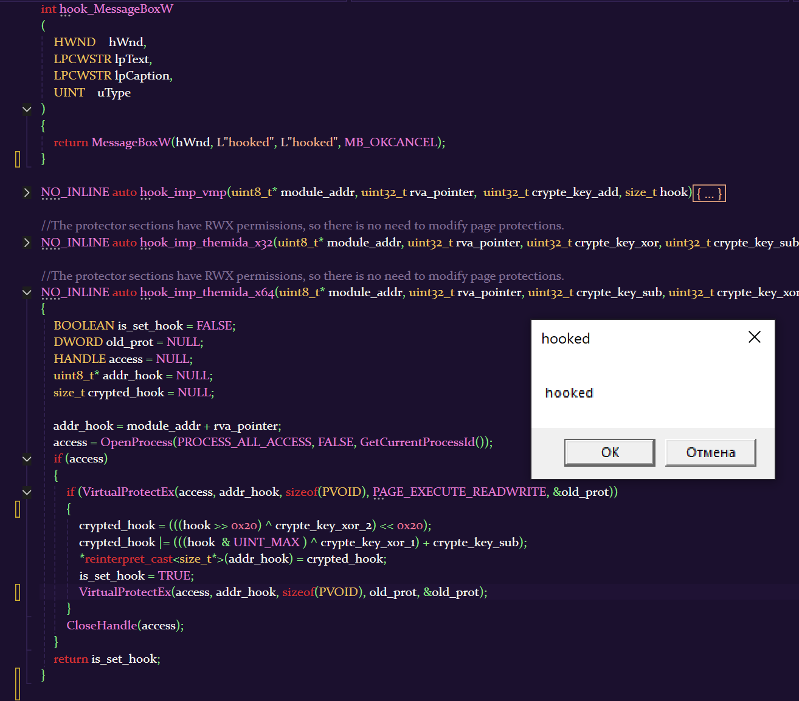
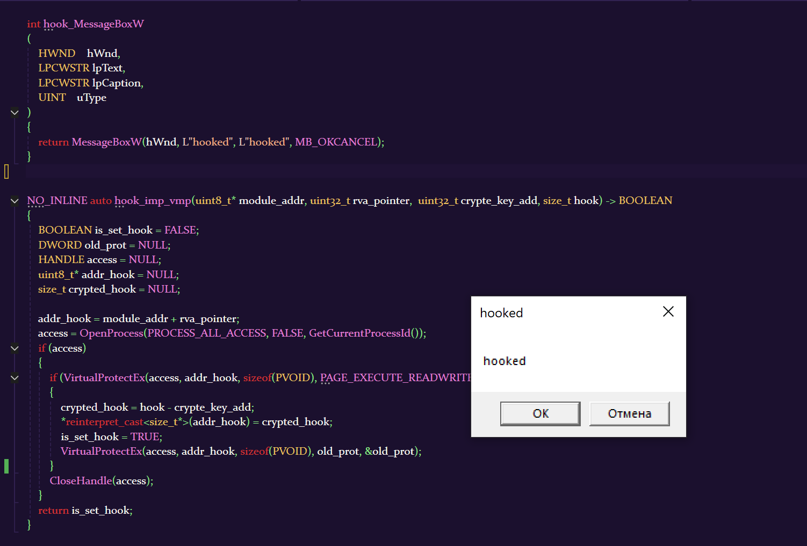

# import_wrapper_attack
This project demonstrates an attack on obfuscated imports protected by VMP/Themida/WinLicense. However, rather than targeting the transition from the program code to the protector code, this project focuses on attacking the import wrapper, regardless of whether a direct transition to it exists.   
Example hook protected import MessageBoxW in Themida 3.2.4.5 ->  
 
Example hook protected import MessageBoxW in VMP 3.10.4 ->  
  
You will need to add the Zydis and unicorn-engine libraries to this project.  
P.S This project was written a long time ago, but I just couldn't finish it for personal reasons.  
Thanks to everyone I spoke with while working on this project.
